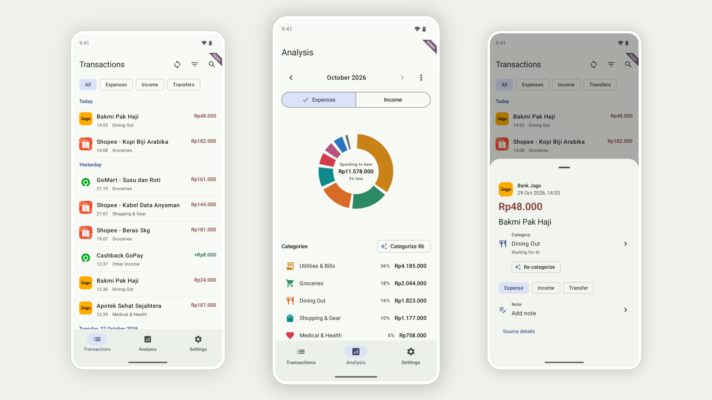

<h1 align="center">Artha</h1>

Artha helps people in Indonesia understand their spending on rooted Android phones. When you open the app, it collects transactions from supported banking, shopping, and ride apps, removes duplicates, and groups spending by category.

## Features

- **Transactions:** One timeline of transfers, expenses and income, deduplicated across providers.
- **Analysis:** Monthly expenses and income by category, compared with the previous month. Expenses and income have separate category lists.
- **Category review:** Step through uncategorized transactions with back and undo, or categorize a whole month by merchant.
- **AI categorization (optional):** Bring your own OpenAI-compatible endpoint. Merchant names and amounts are sent to it, so it is off until you configure it.
- **Remote access (optional):** A public Cloudflare link for AI agents and scripts to read your data. Anyone with the link can read it.
- **Export and import:** JSONL backup of your ledger and edits.
- **Homescreen widgets:** Recent transactions and monthly spending.

## Providers

- **Bank Jago:** Reads and decrypts transaction history cached by the Jago app using root access.
- **Shopee (Marketplace, Food & Digital Products):** Uses the app's saved session cookies to fetch order history and match Jago payments.
- **Gojek & GoPay:** Imports locally saved Gojek orders and payments identified in Jago history.
- **Grab:** Decrypts the app's local session to fetch ride routes, GrabFood orders, and GrabPay history directly.

## Build

Use JDK 21: `./gradlew -p artha testDebugUnitTest assembleDebug`. Reading provider data needs root.

For demos, `./gradlew -p artha assembleDemo` builds "Artha Demo" (`net.wastu.artha.demo`). It installs beside the real app with its own empty data, rebuilds itself each day with a year of invented transactions ending today, and never syncs, so your real ledger is not touched.

<picture>
  <source media="(prefers-color-scheme: dark)" srcset="assets/thumbnail-dark.png">
  <source media="(prefers-color-scheme: light)" srcset="assets/thumbnail-light.png">
  
</picture>

AI disclosure: Human validated.

Licensed under [GPL-3.0](LICENSE).
