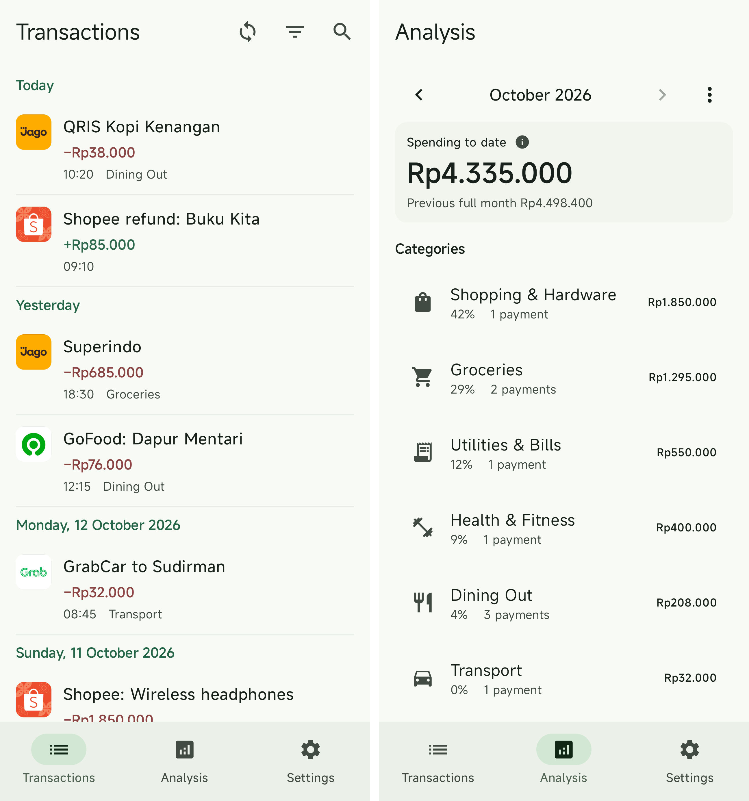

<h1 align="center">Artha</h1>

Artha helps people in Indonesia understand their spending on rooted Android phones. When you open the app, it collects transactions from supported banking, shopping, and ride apps, removes duplicates, and groups spending by category.

## Features

- **Unified timeline:** Automatically collect transactions and reconcile duplicates across providers.
- **Order details:** See food items, shopping purchases, and ride routes.
- **Monthly spending:** Compare categories and totals with the previous month.
- **Spending insights:** Local summaries are ready immediately; AI analysis chooses its own historical comparisons and follow-up queries across saved spending, then reviews its findings and recommendations. Manual categories stay protected.
- **Search and filters:** Find transactions by keyword, provider, or date range.
- **Demo mode:** Explore multi-year fictional payments and example AI analysis from Settings, without changing personal history.
- **Homescreen widgets:** Check recent transactions and monthly spending without opening the app.
- **Encrypted backup:** Back up through Google Drive and explicitly restore missing history, encrypted on-device.

## Providers

- **Bank Jago:** Reads and decrypts transaction history cached by the Jago app using root access.
- **Shopee (Marketplace, Food & Digital Products):** Uses the app's saved session cookies to fetch order history and match Jago payments.
- **Gojek & GoPay:** Imports locally saved Gojek orders and payments identified in Jago history.
- **Grab:** Decrypts the app's local session to fetch ride routes, GrabFood orders, and GrabPay history directly.

<picture>
  <source media="(prefers-color-scheme: dark)" srcset="assets/screenshot-dark.png">
  <source media="(prefers-color-scheme: light)" srcset="assets/screenshot.png">
  
</picture>

AI disclosure: Human validated.

Licensed under [GPL-3.0](LICENSE).
